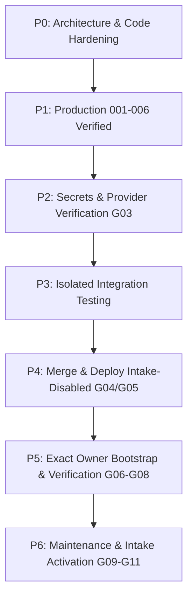

# AEGIS Master Execution Plan

Version 1.1 · Updated 13 October 2026 · Asia/Calcutta (IST)

Companions: [progress ledger](AEGIS_PROGRESS_LEDGER.md), [approval matrix](AEGIS_APPROVAL_MATRIX.md).

---

## 1. Reconciled Baseline & Production Status

- **Database Identity:** Neon project `icy-dust-49902301` (`aegis-production`), database `aegis`, user `neondb_owner`, endpoint `ep-wispy-pond-b33jk0d8.c-4.ap-southeast-1.aws.neon.tech`.
- **Migrations 001–006:** **Verified Applied & Healthy**.
  - `001_stage3.sql`: `3c6c62e7178fe584ec9623909ea8145c9fed79d6f7b46c1f63ebbe4888a0e662`
  - `002_security.sql`: `d28a5c62c5f74ab52da954c219e74f29d174bc9bfe4c4b2351b3b7954b699745`
  - `003_auth_v4_2.sql`: `c184aa966b46b4cb4222d58be820bf3b9aa6498638dc2b928759851d827f7825`
  - `004_institutional_roster.sql`: `ab1aec0e4d73e8c92cdd51928c14afb39c94f3f301186ac37d4ed2c47c1f73af`
  - `005_password_auth.sql`: `d38eac7a8d207ee734ee8c14b44d0236316981ce3f23299eacdc0a6fec992d7b`
  - `006_owner_portal.sql`: `50cb83b13c6401e17df2ab2ef2e02128b8850a4d17c4340595a906e4aa84398b`
- **Application State:** `users: 0`, `complaints: 0`, `departments: 7`, `audit_logs: 0`.
- **Safety Gate:** `LIVE_INTAKE_ENABLED=false` remains intact across repository and production configuration.

---

## 2. Completed Phase P0 Improvements

1. **Storage Signing Secret Hardening (WP-0.2):**
   - Replaced weak hardcoded fallback in `server/storage.js`.
   - Now checks `EVIDENCE_STORAGE_SIGNING_SECRET || SESSION_SECRET`. In production, if unset or <32 characters, fails closed with HTTP 503.
   - Updated `.env.example` with documentation.
2. **Direct Migration Host Enforcement (WP-0.3):**
   - Hardened `scripts/migrate.js` to reject any hostname containing `-pooler` even if mistakenly configured.
3. **Maintenance Cleanup Coverage (WP-0.4):**
   - Updated `server/maintenance.js` `cleanupExpired()` to clean `password_reset_tokens`, `owner_entry_challenges`, and `owner_portal_grants`.

---

## 3. Work Package Execution Roadmap

### Remaining Authorized Work Packages

| Work Package | Focus | Status | Gate Dependency |
| :--- | :--- | :--- | :--- |
| **WP-2.1** | Verify Resend Domain Preflight (Read-Only) | Ready | Gate G03 |
| **WP-2.2** | Verify Cloud Evidence Bucket Configuration | Ready | Gate G03 |
| **WP-4.1** | PR #1 Branch Review & Rollback Check | Ready | Gate G04 |
| **WP-5.1** | Candidate Sign-in & Read-Only Preparation | Gated | Gate G06 |
| **WP-5.2** | Exact Single-Owner Bootstrap Transaction | Gated | Gate G07 |
| **WP-5.3** | Live Owner PIN Setup & Authenticator Enrollment | Gated | Gate G08 |
| **WP-6.1** | Cron Secret Configuration & Route Verification | Gated | Gate G09 |
| **WP-6.2** | Intake Activation & Synthetic Smoke Test | Gated | Gate G10 |
